  

  

  
  

---

## About Me

I am an undergraduate in Computer Science and Engineering (AI & ML) at M.S. Ramaiah Institute of Technology, Bengaluru, with a CGPA of 9.3. I build applied AI systems end to end: fine-tuning models, designing retrieval and agentic pipelines, and shipping them behind usable APIs and interfaces.

My current focus is **Generative AI**, **Agentic AI** and **Retrieval-Augmented Generation**, along with the full-stack engineering that turns a model into a working product. I care about reliability as much as capability, which means structured outputs, validation and clear documentation for every system I ship.

I am open to internship opportunities in AI/ML, software engineering and technical content roles.

---

## Experience

**Data Scientist Intern, Innodatatics** &nbsp;|&nbsp; Aug 2025 to Nov 2025
- Fine-tuned `facebook/detr-resnet-50` with Hugging Face Transformers for document layout detection, including COCO annotation conversion and a custom PyTorch dataset.
- Built an AI travel-planning feature on FastAPI with Ollama-hosted LLMs, using system prompts and JSON-schema validation for consistent itinerary output.
- Deployed inference pipelines with automated preprocessing, reducing latency by 20%.

---

## Featured Projects

### 🛟 [HALO Support](https://github.com/Vigyant05/IT_ticket_solver)
`LangGraph` `ChromaDB` `Groq` `FastAPI` `Next.js` `n8n`
- An AI helpdesk that reads every incoming IT ticket, decides how to handle it and acts with zero manual dispatch: it automates fixes through n8n, answers FAQs from a RAG knowledge base, or routes hard cases to the right human expert.
- Ships with Admin, Employee and User portals, live AI telemetry, an API reference and a step-by-step setup and troubleshooting guide. Co-authored research paper on the system.

### 📄 [Document Layout Detection](https://github.com/Vigyant05/DETR_Training_Code)
`PyTorch` `Hugging Face Transformers` `DETR` `Tesseract OCR`
- Teaches a transformer to see the structure of a page, locating titles, text blocks, lists, tables and figures, and reached 0.87 mAP after fine-tuning on 8,000 documents.
- A complete pipeline, not just a notebook: COCO conversion, OCR-based deskewing for multilingual scans, batch inference and clean JSON output.

### 🫀 [HeartGuard AI](https://github.com/Vigyant05/Heart-Disease-Classification)
`Scikit-learn` `XGBoost` `CatBoost` `FastAPI` `Next.js`
- Screens patient clinical data for five cardiovascular conditions, each with its own tuned model, reaching up to 96.7% accuracy on heart attack detection.
- Wrapped in a full-stack app with real-time predictions, file upload, an interactive chat diagnosis flow and explainable results.

### ✈️ [Yatra AI](https://github.com/Vigyant05/YatraAI)
`Gemini on Vertex AI` `Google Maps API` `FastAPI` `React` `Supabase`
- Turns a destination, dates, budget and interests into a day-by-day itinerary grounded in real places and live weather forecasts, in 9 languages.
- Validates every AI response against a strict JSON structure, saves trips per user with Supabase and exports the final plan as a PDF.

### 🎮 [AI NPCs](https://github.com/Vigyant05/AI_NPCs)
`LLaMA 3` `React` `Three.js` `Python` &nbsp; 🏆 Samsung PRISM GenAI Hackathon '25 finalist
- A village where every character is an LLM with its own personality, memory and relationships, and rumours spread from NPC to NPC as you play.
- Live weather changes the world and the NPCs' mood, and a real Philips Wiz smart bulb changes colour with each conversation and event.

### 🏏 Fantasy Team Prediction
`XGBoost` `Selenium` `BeautifulSoup`
- Picks a fantasy cricket team for upcoming matches using an XGBoost model with 0.90 precision, built for the Dream11 Gameathon.
- Trained on player form, venue and historical match data collected through an automated web scraper.

---|---|---|
| [**HALO Support**](https://github.com/Vigyant05/IT_ticket_solver) | Agentic, RAG-powered IT ticket system that classifies, prioritizes and routes helpdesk tickets and generates context-aware troubleshooting steps. | LangGraph, ChromaDB, FastAPI, Next.js, n8n |
| [**Document Layout Detection**](https://github.com/Vigyant05/DETR_Training_Code) | Fine-tuned DETR on 8,000 training images, reaching 0.87 mAP, with structured JSON output. | PyTorch, Transformers |
| [**Heart Health Diagnostic Tool**](https://github.com/Vigyant05/Heart-Disease-Classification) | Full-stack app predicting five heart conditions with 85 to 90% accuracy and explainable insights. | Scikit-learn, FastAPI, Next.js |
| [**YatraAI**](https://github.com/Vigyant05/YatraAI) | AI travel planner generating personalized multi-day itineraries with live weather and location data. | Ollama, Supabase, FastAPI |
| [**AI NPCs**](https://github.com/Vigyant05/AI_NPCs) | 2D adventure game with LLM-driven NPCs, persistent memory and dynamic world interactions. Samsung PRISM GenAI Hackathon '25 finalist. | LLMs, Python |
| **Fantasy Team Prediction** | XGBoost model with 0.90 precision, built on scraped player, venue and match data. | XGBoost, Selenium, BeautifulSoup |

---

## Research

- **Agentic Support System: RAG-Powered IT Ticket Triage and Automation**: co-author; paper prepared for Springer Nature journal submission.
- **A Distributed Multi-Agent RAG System for Large Codebases**: in progress.

---

## Tech Stack

  <picture>
    <source media="(prefers-color-scheme: dark)" srcset="./profile/tech-sphere-dark.svg" />
    <source media="(prefers-color-scheme: light)" srcset="./profile/tech-sphere-light.svg" />
    
  </picture>

---

## Leadership & Activities

- **Samsung PRISM GenAI Hackathon '25**: Finalist.
- **DeepStation Tech Core Member**: organising committee for the Google x DeepStation Hackathon; mentored teams through technical roadblocks.
- **IEEE Xtreme Execom**: IEEE Bangalore Section.

---

## GitHub Stats

  
  

  

---

  <i>"The best way to predict the future is to invent it."</i> Alan Kay

